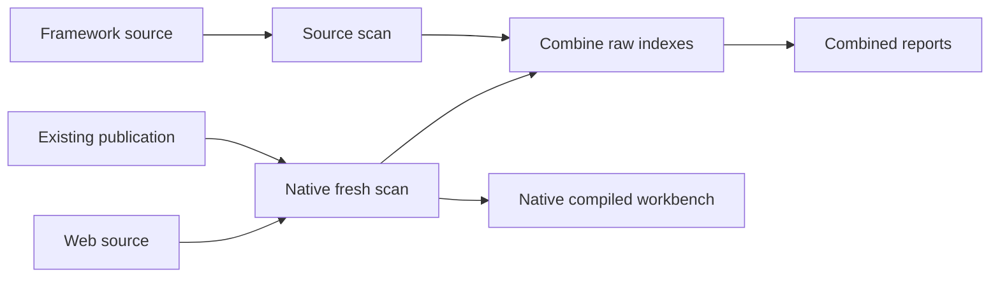

# Collect web source, framework source and a compiled publication

Use a workspace to collect all three evidence channels and open one starting
report. Native fresh collection reads web source and an explicitly selected
publication into one raw scan; framework source gets a separate raw scan. The
workspace combines those **two** indexes. Database definitions are not ingested.



## Try the synthetic example

From the TraceMap checkout, prepare the tool:

```bash
pwsh -NoProfile -File ./scripts/tm.ps1 -Build version
```

From macOS Terminal (zsh/bash), run this as one line:

```bash
pwsh -NoProfile -File ./scripts/tests/Test-WorkspaceLauncher.ps1 -WithCompiled -OutputRoot "$HOME/tracemap-reviews/compiled-trial-01"
```

From a PowerShell prompt:

```powershell
pwsh -NoProfile -File ./scripts/tests/Test-WorkspaceLauncher.ps1 -WithCompiled -OutputRoot (Join-Path $HOME 'tracemap-reviews/compiled-trial-01')
```

The trial authors two small source repositories, builds their managed assemblies,
creates an explicit synthetic page map, prepares native receipts for those exact
toy inputs, then verifies and collects them. It also checks a web-only repository
filter. The fixture uses the CLI project's declared target framework and an
explicit publish directory, not an SDK-derived `Debug/net10.0` path.

This is a managed metadata/IL and source workflow trial. It does not run IIS or
prove native Windows ASP.NET publication. Its explicit source/publication
declaration applies only to the freshly authored synthetic fixture.

Open the printed `START-HERE.md`. Existing trial folders are preserved; inspect
their results rather than rerunning into the same folder.

## Configure your application

First obtain a prepared native configuration with schema
`webforms-compiled-review-config.v1`, operation `fresh`, explicit DLL/dependency
selection, and existing compiled-binding and publish receipts. See the
[native workflow](WEBFORMS_NATIVE_WORKFLOW.md) and
[retained-proof migration](WEBFORMS_CONFIG_MIGRATION.md#reuse-the-unchanged-retained-publish-proof).
Preparation needs an explicit owner declaration of exact source correspondence.
The workspace never invents that declaration or modifies your native config.

An owner-reported `webforms-compile-web-config.v1` file is a different schema;
its migration is still unverified. Do not rename its schema or field names.
An `attach` native config is also outside this first workspace route.

Initialize a workspace using the [source getting-started guide](WORKSPACE_GETTING_STARTED.md).
Then edit `workspace.local.json` to use v2. This Windows-path example must be
adapted to your actual locations:

```json
{
  "schemaVersion": "tracemap-workspace.v2",
  "repositories": [
    { "id": "web", "path": "C:/source/WebApp", "projects": [] },
    { "id": "framework", "path": "C:/source/GenericFramework", "projects": ["GenericFramework.csproj"] }
  ],
  "scopeFile": null,
  "webFormsReport": true,
  "compiledReview": {
    "repositoryId": "web",
    "nativeConfigPath": "C:/reviews/WebApp/native-evidence/review-config.local.json"
  }
}
```

The web `path` must match the native config's `sourceRoot`, whose commit must
match Git HEAD. Its `projects` stays empty: web project/folder/page selection
belongs to the native config. Do not add workspace web solution, glob or target
overrides; conflicting authorities are refused. Framework selection uses the
normal workspace fields. Relative config paths resolve from the workspace.

## Verify and collect

```powershell
pwsh -NoProfile -File ./scripts/tm.ps1 workspace verify --root C:/reviews/WebApp
pwsh -NoProfile -File ./scripts/tm.ps1 workspace collect --root C:/reviews/WebApp --out C:/reviews/WebApp/runs/compiled-first
```

Verification is read-only. It checks source identity, native configuration and
selected files, primary assembly bindings and publish receipts using existing
native/Core validators. A scope filter that excludes the configured web source
is refused before collection. Missing, incompatible or changed inputs stop the
run; no repository build, restore, fetch or database connection is requested.

Collection executes native fresh review for the web source, verifies its completed
checkpoint chain, selects the checkpoint-owned **raw** scan, scans framework
source and combines the raw indexes. It rechecks native artifacts and consumed
indexes before publishing completion. Failures retain their exact output folders.

## Read the result

`START-HERE.md` links the combined dependency report, each source report and the
native compiled workbench. The optional `webforms/` packet covers the combined
source inputs. `workspace-run.local.json` records the native preflight/checkpoint
hashes and exact raw scan/report locations alongside the workspace input map.

The native bundle and combined reports have their own index identities. Keep the
native bundle intact; do not copy its document pointers into the combined index
or relabel its unresolved calls. Framework source and dependency-assembly context
remain distinct evidence. Combining them does not prove every call resolves.

Completed compiled collections remain **partial** static reviews: source/build
correspondence is an integrity/declaration boundary, not authenticated compilation,
source-line identity, deployment or runtime proof. Native gaps remain visible.
The V3 SQL sidecar uses a separate admission contract, linked below. Workspace
retained-source attach, caching and legacy-output parity remain follow-up work. All real inputs, outputs and fingerprints are local-only.

For the opt-in offline SQL sidecar and the combined synthetic trial, see
[SQL collection getting started](WORKSPACE_SQL_GETTING_STARTED.md).
